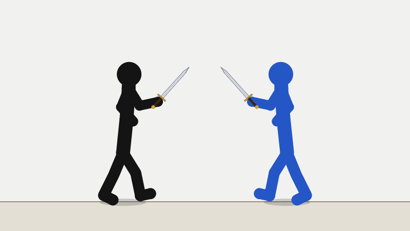
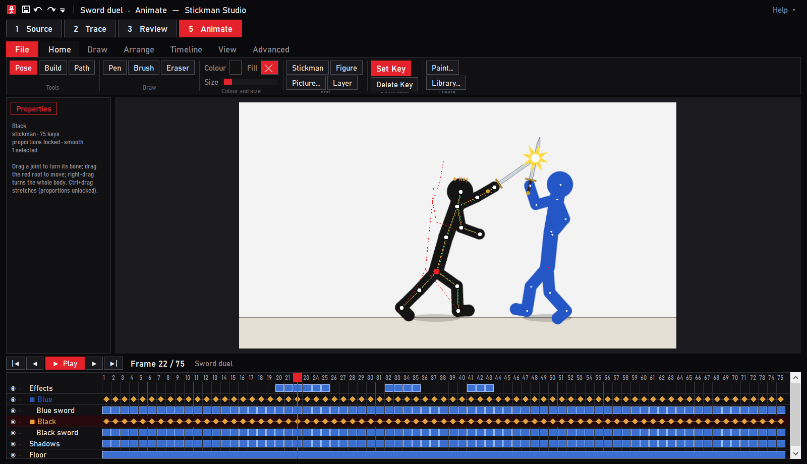
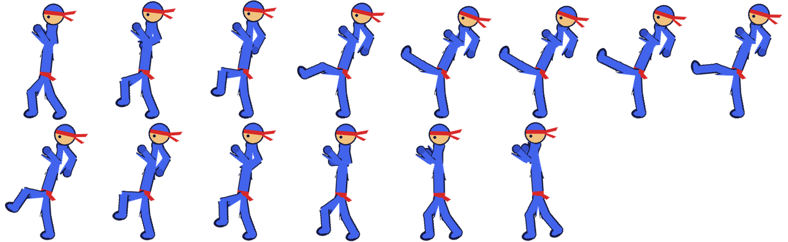

<p align="center">
  <picture>
    <source media="(prefers-color-scheme: dark)" srcset="docs/banner-dark.svg">
    
  </picture>
</p>

<p align="center">
  <a href="https://github.com/isaacreign97/stickman-studio/releases/latest"></a>
  
  <a href="LICENSE"></a>
  
</p>

<p align="center">
  <a href="#download-and-install-windows-10--11-64-bit"><b>Download</b></a> &nbsp;·&nbsp;
  <a href="#what-it-does"><b>Features</b></a> &nbsp;·&nbsp;
  <a href="#run-from-the-source-code"><b>Run from source</b></a> &nbsp;·&nbsp;
  <a href="#build-the-windows-download-yourself"><b>Build</b></a> &nbsp;·&nbsp;
  <a href="#licence"><b>Licence</b></a>
</p>

<p align="center">
  
  <br><sub><i>Made in Stickman Studio's Animate screen: two stickmen, 25 fps, a seamless loop.</i></sub>
</p>

<table align="center">
  <tr>
    <td align="center" width="33%"><h3>🎬 Trace</h3>Open any video, click the 12 joints on a few key frames. The in-betweens are made for you.</td>
    <td align="center" width="33%"><h3>🦴 Animate</h3>No video? Pose stickmen like puppets, draw frame by frame, or rig your own drawings.</td>
    <td align="center" width="33%"><h3>🎮 Ship</h3>Export GIF, MP4, PNG frames and sprite sheets with JSON for Unity and other engines.</td>
  </tr>
</table>

Stickman Studio is a free Windows app for making 2D stickman animation. No AI, no account, no internet:
everything is plain geometry running on your own computer.

<p align="center">
  
  <br><sub><i>The Animate screen: pose with joint handles, onion skin of the keys before and after, and one timeline for every character and drawing layer.</i></sub>
</p>

## Download and install (Windows 10 / 11, 64-bit)

1. Open the [**Releases**](../../releases/latest) page and download `Stickman-Studio-…-windows-x64.zip`.
2. Unzip it anywhere (for example your Desktop or `C:\Programs`). Keep the whole folder together.
3. Double-click **`Stickman Studio.exe`**. A short tour shows you around the first time (F1 brings it back).

Your work is saved in **`Documents\Stickman Studio`**. Nothing needs installing: Python and every library are
inside the folder. To uninstall, delete the folder.

> **"Windows protected your PC"?** The app isn't code-signed yet, so Windows SmartScreen warns about it the first
> time. Click **More info → Run anyway**. The full source code is in this repository, and you can build the
> .exe yourself (see below).

## What it does

| Screen | What you do there |
|---|---|
| **1 Source** | Open a video, GIF or pictures. Step through it frame by frame, mark the move (I / O) and save its frames. |
| **2 Trace** | Pick the key frames and click the 12 joints (head, neck, waist, hip, knees, feet, elbows, hands). Faded copies of the last frame, carry-forward, smoothing, motion trails, zoom, undo history and automatic backups help. Several fighters in one video can each get their own trace. |
| **3 Review** | Watch the trace as a clean stickman at the real speed. Fix a slanted camera, zoom changes or floating feet, make it run in place, find key poses, compare versions and measure speeds and angles. |
| **5 Animate** | Animate without a video: drag joints to pose (bones never stretch by accident), set keys and let the in-betweens be made; draw frame by frame with onion skin and layers; paint pictures; rig your own drawings to the skeleton; several characters, a shared timeline, branching stories and a library of reusable characters and props. |

**Export:** GIF, MP4 video, PNG frames (transparent if you like), pose data (JSON / CSV) and **sprite sheets** with
JSON metadata (frame positions, timing and pivots) for Unity and other engines.



**Skeleton:** 12 joints, plus 6 optional ones (shoulders, hand tips and toes) you can add only where you need them.

## Run from the source code

Needs Python 3.11 or newer (developed on 3.14) on Windows.

```
py -m pip install -r requirements.txt
py stickman_studio\studio.py
```

Or double-click `Run Stickman Studio.bat`. Options: `--images <folder>` (where moves are kept), and drag a video,
GIF or pictures onto the .bat to open them.

## Build the Windows download yourself

```
py -m pip install -r requirements.txt pyinstaller
py build_exe.py
```

This makes `dist\Stickman Studio\` (the .exe with its own Python built in, and the app's scripts in `app\`) and a
ready-to-upload `.zip`.

## Licence

Stickman Studio is open source under the [MIT licence](LICENSE). The download also contains Python, Tk, Pillow,
NumPy and OpenCV (with FFmpeg), each under its own licence: see [THIRD_PARTY_NOTICES.md](THIRD_PARTY_NOTICES.md).

Only trace videos you have the right to use. Moves you make are yours.
